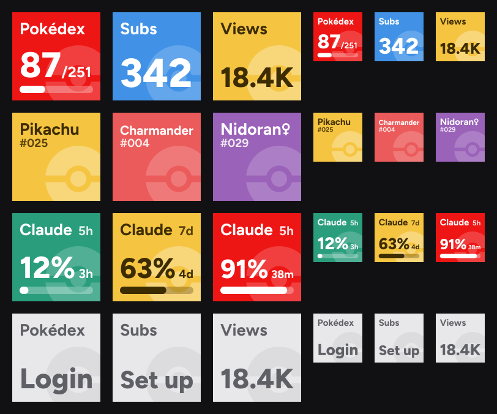

# Pokédex with Dad for Stream Deck

Keys for an Elgato Stream Deck, drawn like the tiles in the
[Pokédex app](https://github.com/alexanderjuulj/pokedex-tcg): how much of the
Pokédex is caught and what you caught last, the YouTube channel's subscribers and
total views, and how much of Claude's usage limits is gone.



| Key | Shows | Press |
| --- | --- | --- |
| **Pokédex count** | Caught of the goal, with a bar | Opens the Pokédex |
| **Last caught** | The newest Pokémon of the goal, in its type color with its artwork | Opens its page |
| **Subscribers** | The channel's subscribers | Opens YouTube Studio |
| **Total views** | The channel's total views | Opens YouTube Studio |
| **Claude 5h usage** | The 5-hour limit used, and the time until it resets | Opens Claude's usage page |
| **Claude weekly usage** | The weekly limit used, and the time until it resets | Opens Claude's usage page |

The numbers refresh every 10 minutes (Claude's every 5) while a key is on screen.
Claude's keys color like an HP bar: green, yellow from 50% used, red from 80%. A
gray key needs attention or is out of date:

| Gray key says | Means |
| --- | --- |
| Set up | Its settings aren't filled in |
| Login | The Pokédex refused the login. Save it again to retry |
| API key | YouTube refused the API key |
| Channel | YouTube can't find the channel |
| Sign in | Claude Code isn't logged in on this Mac |
| None yet | No Pokémon of the goal has a card yet |
| Offline | No answer yet. A number in gray is the last one it got |

## Install

Needs macOS, Stream Deck 7.1 or later, Node and pnpm.

```sh
pnpm install
pnpm build
pnpm deck:link
```

The plugin runs from this folder, so keep it here. Stream Deck only looks for new
plugins when it starts, so quit it and open it again. Then drag the keys from
**Pokédex with Dad** in its action list, and click one to set it up:

- **Pokédex count or Last caught:** the app's address, username and password. Both
  keys share these, and the password goes in the macOS Keychain.
- **Subscribers or Total views:** a YouTube API key
  ([Google Cloud](https://console.cloud.google.com/apis/credentials), with the
  YouTube Data API v3 switched on) and the channel, as a `UC…` ID or an
  `@handle`. Both keys share these. A refresh uses 1 of the key's 10,000 free
  units a day.
- **Claude:** nothing to fill in. They read Claude Code's login from the Keychain,
  so Claude Code has to be logged in on this Mac. The login is only sent to
  Anthropic, and never refreshed from here: Claude Code does that itself, so an
  expired one shows the last number in gray until Claude Code next runs. The usage
  endpoint isn't a documented API, so it could change without notice.

## Working on it

```sh
pnpm lint          # type check
pnpm build         # bundle src/ into the plugin folder
pnpm deck:restart  # run the new build
pnpm deck:validate # check the plugin against Elgato's rules
pnpm images        # redraw the fixed images and preview.png from src/keys/draw.ts
pnpm glyphs        # regenerate the Figtree outlines
```

- `src/keys/draw.ts` draws the tiles. They're SVG with the text as outlines
  (`glyphs.ts`), so they look the same whether or not Figtree is installed.
- Last caught has a picture in it, so `raster.ts` renders that key to a PNG (resvg,
  as WebAssembly), and `art.ts` first turns the app's WebP into PNG with macOS's
  `sips`, as resvg can't read WebP. The artwork comes from the app when the Pokémon
  changes, and is only kept in memory: none of it is in this repository.
- `src/poller.ts` keeps each source's latest value, and only asks while a key
  showing it is on screen.
- `src/sources/` talks to the Pokédex, YouTube and Claude.
- `src/actions/` holds the keys, and `*.sdPlugin/ui/` their settings panels.

The app locks an address out after 5 failed logins, so a refused login is never
retried by itself: only saving the login again clears it (`refused` in
`src/sources/pokedex.ts`). Keep it that way, or a changed password could lock out
the family's phones on the same Wi-Fi.

Logs are in `*.sdPlugin/logs/`.

## License

The code is MIT licensed ([LICENSE](LICENSE)). The font outlines, icons and
settings-panel library it bundles keep their own licenses, in
[THIRD-PARTY-LICENSES.md](THIRD-PARTY-LICENSES.md).

Pokémon and its trademarks are © Nintendo, Creatures and GAME FREAK, and this is a
fan project, not affiliated with or endorsed by any of them, or by Google, Elgato or
Anthropic. None of the Pokémon artwork is in this repository: the Last caught key
fetches a picture from your own copy of the Pokédex app.
